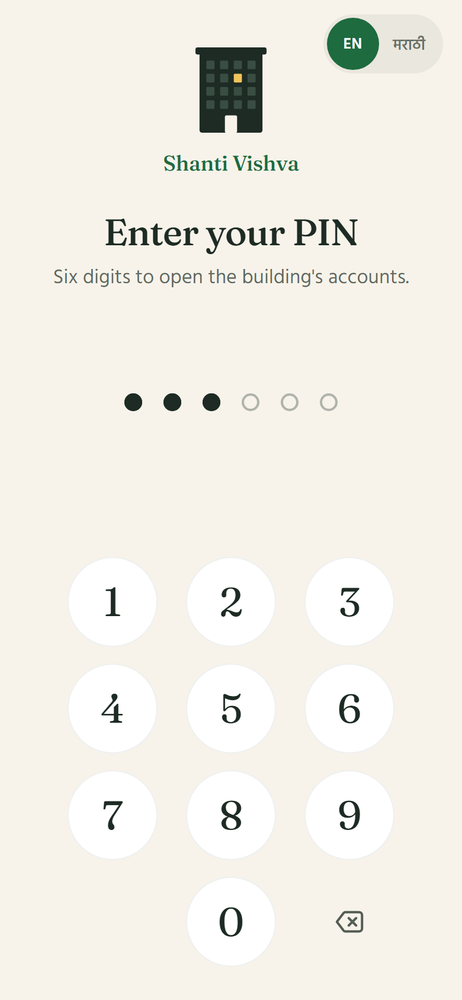
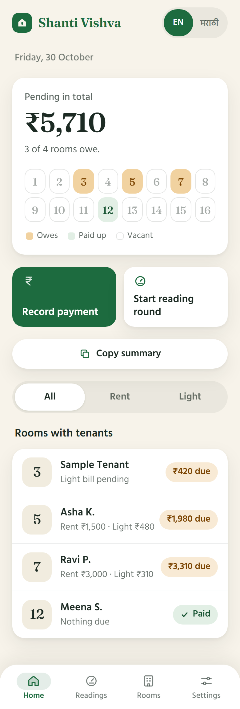
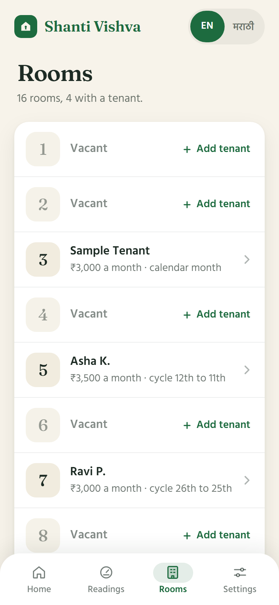
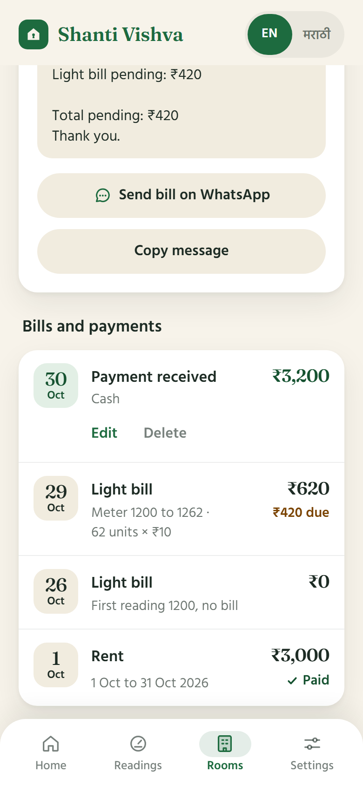
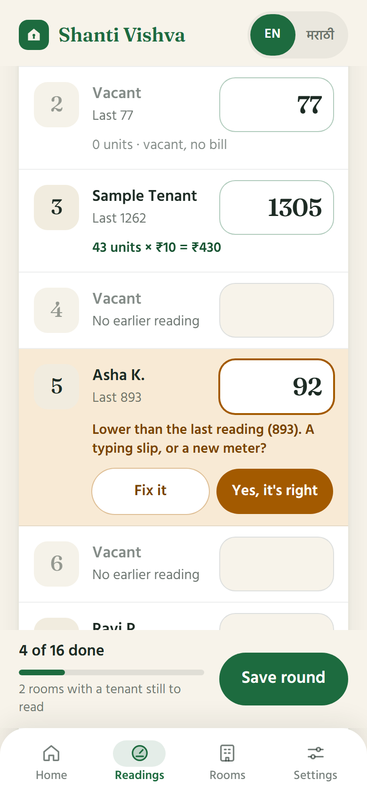
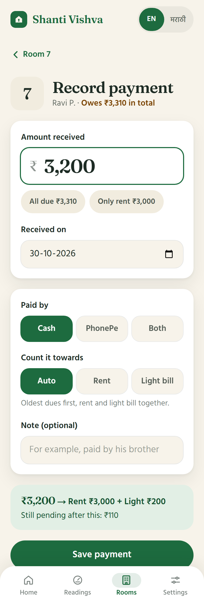
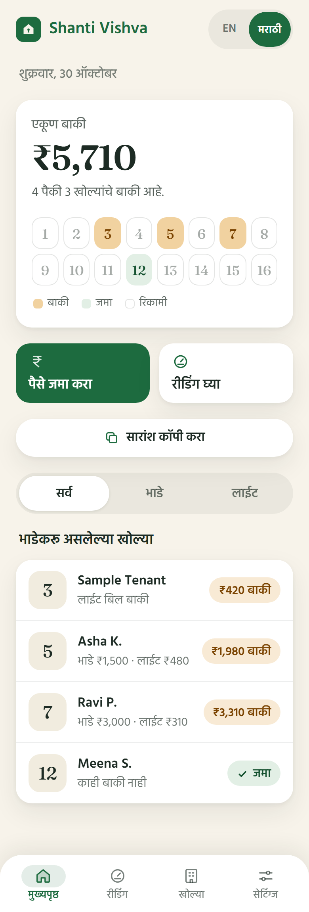
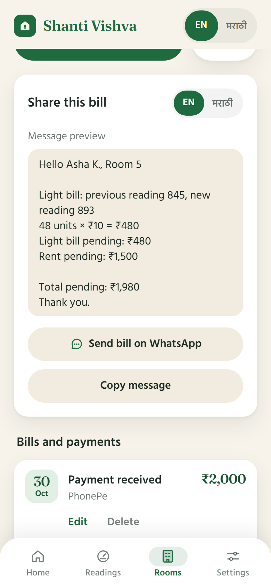

# Shanti Vishva

A phone-first app for keeping a small building's rent and light-bill accounts, in English and Marathi.

## Screenshots

All screenshots use made-up demo data.

<table>
  <tr>
    <td align="center" valign="top"><br><sub>PIN lock</sub></td>
    <td align="center" valign="top"><br><sub>Home: what is pending, room by room</sub></td>
    <td align="center" valign="top"><br><sub>Rooms and tenants</sub></td>
    <td align="center" valign="top"><br><sub>A room's bills and payments</sub></td>
  </tr>
  <tr>
    <td align="center" valign="top"><br><sub>Meter readings with a mistake warning</sub></td>
    <td align="center" valign="top"><br><sub>Payment, split between rent and light</sub></td>
    <td align="center" valign="top"><br><sub>Home in Marathi</sub></td>
    <td align="center" valign="top"><br><sub>Send the bill on WhatsApp</sub></td>
  </tr>
</table>

## Features

- PIN lock: six digits to open the accounts, with lockout after wrong tries.
- Rent and light-bill tracking per room, with each tenant's own rent month.
- Meter reading rounds: one list for all rooms, a live "units x rate" bill, and warnings for readings that look wrong.
- Cash, PhonePe or both, with the payment split automatically between rent and light.
- Bill sharing on WhatsApp, in English or Marathi.
- English and Marathi screens.
- Installable on a phone from the browser.
- One-time import of meter-reading history from Excel.

## Tech stack

Next.js, TypeScript, Tailwind, Supabase, Vercel.

## Run locally

No database is needed to try it out. Set `REPO=memory` to use a throwaway in-memory store (data is lost on restart). The app also needs a `SESSION_SECRET` of at least 32 characters.

```powershell
$env:REPO="memory"; $env:SESSION_SECRET="<any long random string>"; npm run dev
```

Then open http://localhost:3000 and choose a PIN. `npm test` runs the tests and `npm run build` makes a production build.

## Setup and guide

- [docs/SETUP.md](docs/SETUP.md): setting it up for real use (database, deployment, importing old readings).
- [docs/guide-mr.pdf](docs/guide-mr.pdf): user guide in Marathi.
